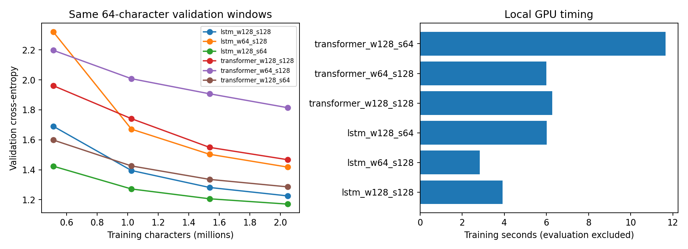
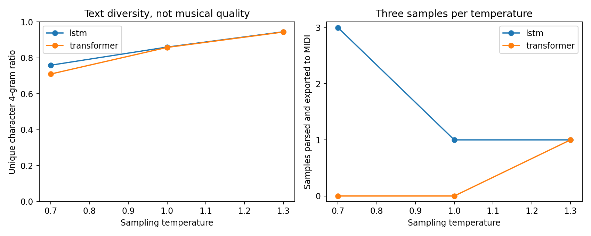

# LSTM vs. Transformer for music generation

A character-level music generation project based on [MIT 6.S191 Lab 1](https://github.com/MITDeepLearning/introtodeeplearning/blob/master/lab1/PT_Part2_Music_Generation.ipynb).

The input is ABC notation: plain text that describes notes, timing and other score information. Both models learn to predict the next character. After training, they generate new text one character at a time.

I compare an LSTM with a small causal Transformer, then change the model width, training sequence length and sampling temperature. The results below come from fresh runs of this version of the code on October 19, 2026.

## Models and data

- **LSTM:** character embedding, two LSTM layers and a linear output layer.
- **Transformer:** character and position embeddings, two causal attention blocks and a linear output layer. Each block has four attention heads.
- Both use dropout 0.1, AdamW with learning rate 0.001, gradient clipping at 1.0 and seed 42.

The pinned MIT dataset contains 804 tunes when split at their `X:` headers. There are 724 training tunes and 80 validation tunes. Tunes with identical content after removing IDs, titles and attribution headers stay in the same split. Training windows never cross a tune boundary.

The vocabulary comes from the training split. It has 82 characters plus an unknown-character token; one validation character maps to that token. The data is downloaded and checked against a SHA-256 hash.

## Training results

Each run sees 2,048,000 target characters with batch size 16. A sequence length of 128 takes 1,000 updates; a length of 64 takes 2,000. All runs are evaluated on the same 64-character validation windows.

| Model | Width | Training sequence length | Parameters | Validation loss | Training time |
|---|---:|---:|---:|---:|---:|
| LSTM | 128 | 128 | 285,523 | 1.225 | 3.91 s |
| LSTM | 64 | 128 | 77,267 | 1.417 | 2.84 s |
| LSTM | 128 | 64 | 285,523 | 1.170 | 6.02 s |
| Transformer | 128 | 128 | 302,931 | 1.467 | 6.28 s |
| Transformer | 64 | 128 | 85,971 | 1.814 | 6.00 s |
| Transformer | 128 | 64 | 302,931 | 1.286 | 11.66 s |

In these runs, the LSTM had a lower validation loss than the corresponding Transformer. Increasing width from 64 to 128 helped both models. Shorter training sequences also gave lower loss, but they used twice as many updates, and validation uses short contexts. This does not show that shorter sequences are always better for music.

Times were measured on an RTX 5060 Ti 16GB in FP32. They include forward, backward and optimizer work with GPU synchronization, but exclude validation, sampling and batch selection. They are small local measurements, not a general speed benchmark.



## Sampling temperature

The width-128, sequence-128 models generated three samples at each temperature, using sampling seeds 101, 102 and 103. Every sample starts with the same ABC header and generates at most 512 additional characters. Both models use a rolling 128-character context during generation.

| Model | Temperature | Mean unique character 4-gram ratio | MIDI exports |
|---|---:|---:|---:|
| LSTM | 0.7 | 0.760 | 3/3 |
| LSTM | 1.0 | 0.861 | 1/3 |
| LSTM | 1.3 | 0.946 | 1/3 |
| Transformer | 0.7 | 0.711 | 0/3 |
| Transformer | 1.0 | 0.859 | 0/3 |
| Transformer | 1.3 | 0.944 | 1/3 |

Higher temperatures produced more varied character sequences here. More text diversity did not reliably produce usable notation. The LSTM at temperature 0.7 had the most successful MIDI exports in this small sample.

Music21 can repair malformed notation and issued warnings for some samples. **An exported MIDI is not proof of valid ABC, good rhythm or good music.** Most outputs reached the character limit. I have not measured long-range musical structure or completed a listening evaluation.

The ABC files and successful MIDI exports are in `results/samples/`. Open a `.mid` file in a MIDI player to listen. Failed outputs are kept as well.



## Run locally

The recorded environment used Python 3.12 and PyTorch 2.10. Install a CUDA build of PyTorch for GPU training; CPU execution also works but will be slower.

```bash
python -m venv .venv
# Activate the environment using the command for your shell.
python -m pip install -r requirements.txt
python test_models.py
python run_experiments.py
python sample.py
python plot_results.py
```

The scripts download the dataset if needed. New checkpoints and outputs go into `runs/`; the recorded results in `results/` are kept separate. To repeat training, use a different folder:

```bash
python run_experiments.py --output runs_second
python sample.py --runs runs_second
python plot_results.py --runs runs_second
```

`experiments.ipynb` provides the same steps for Colab. Upload the repository ZIP and select a GPU runtime. The notebook has been checked for syntax; the recorded experiments were run locally.

## Files

- `data.py`: download, tune grouping, vocabulary and sequence windows.
- `models.py`: LSTM and Transformer definitions.
- `train.py`: next-character training and validation.
- `run_experiments.py`: the six experiment settings.
- `sample.py`: temperature sampling and MIDI export attempts.
- `test_models.py`: target-shift, split and causal-mask checks.
- `results/`: saved metrics, examples and plots.

## Limits and sources

This is a small course-based experiment with one training seed and one split. The architectures have similar but unequal parameter counts. The sequence comparison matches training characters, not optimizer updates or FLOPs, and different lengths admit different windows. The shared learning rate was not tuned separately for each architecture. No separate test set was used, so these are validation results rather than a final benchmark.

The source task and ABC data come from [MIT Introduction to Deep Learning](https://github.com/MITDeepLearning/introtodeeplearning). `data_source.json` records the exact data revision and hash. The Transformer comparison and experiment scripts are extensions to the course exercise. This is not an original model architecture or a claim that Transformers are generally worse than LSTMs.
